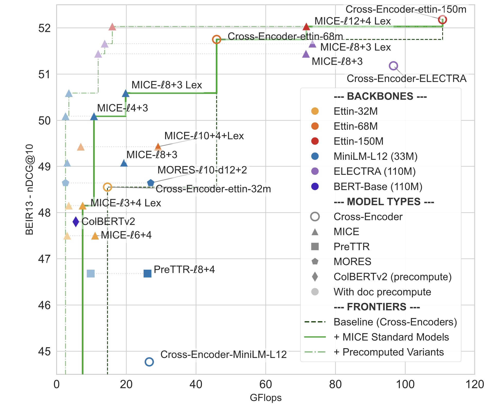
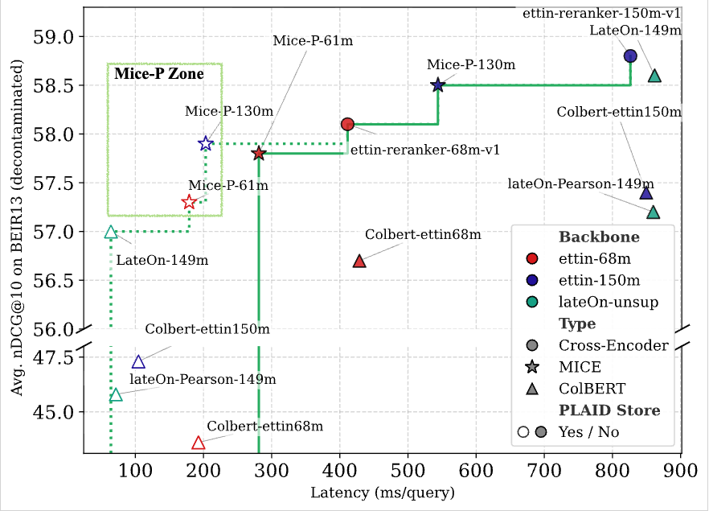
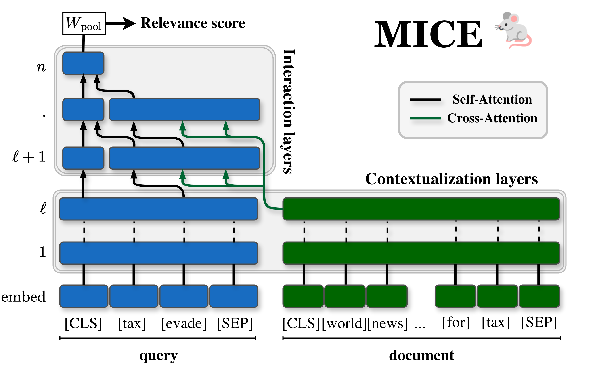

<div align="center">

<h1>MICE 🐭 - Minimal Interaction Cross-Encoders</h1>
<div>
    <a href="https://scholar.google.com/citations?user=QGCo1PAAAAAJ&hl" target="_blank">Mathias Vast*</a><sup>1,2</sup>&emsp;
    <a href="https://victormorand.github.io/" target="_blank">Victor Morand*</a><sup>1</sup>&emsp;
    <a href="https://yzong12138.github.io/" target="_blank">Yuxuan Zong</a><sup>1</sup>&emsp;
    <a href="https://scholar.google.com/citations?user=V-Nyr0wAAAAJ" target="_blank">Josiane Mothe</a><sup>3</sup>&emsp;
    <a href="https://www.piwowarski.fr" target="_blank">Benjamin Piwowarski</a><sup>1</sup>&emsp;
</div>
<br>
<div>
    <sup>1</sup>Sorbonne Université, CNRS, ISIR, F-75005 Paris, France&emsp;<br>
    <sup>2</sup>ChapsVision, Paris, France&emsp;<br>
    <sup>3</sup>IRIT, Université de Toulouse, UMR5505 CNRS, F-31400 Toulouse, France&emsp;<br>
</div>
<br>

[](https://arxiv.org/abs/2602.16299)
[](https://arxiv.org/abs/2610.31932)
[](https://huggingface.co/collections/xpmir/mice)
[](https://github.com/xpmir/mice)
[](https://github.com/xpmir/cross-encoders)
[](https://github.com/astral-sh/uv)
[](https://github.com/experimaestro/experimaestro-python)

</div>

### 📄 Abstract (EMNLP 2026)

> Cross-encoders deliver state-of-the-art ranking effectiveness in information retrieval, but have a high inference cost. This prevents them from being used as first-stage rankers, but also incurs a cost when re-ranking documents. Prior work has addressed this bottleneck from two largely separate directions: accelerating cross-encoder inference by sparsifying the attention process or improving first-stage retrieval effectiveness using more complex models, e.g. late-interaction ones.
> In this work, we propose to bridge these two approaches, based on an in-depth understanding of the internal mechanisms of cross-encoders. Starting from cross-encoders, we show that it is possible to derive a new late-interaction-like architecture by carefully removing detrimental or unnecessary interactions. We name this architecture MICE (Minimal Interaction Cross-Encoders). We extensively evaluate MICE across both in-domain (ID) and out-of-domain (OOD) datasets.
> MICE decreases fourfold the inference latency compared to standard cross-encoders, matching late-interaction models like ColBERT while retaining most of cross-encoder ID effectiveness and demonstrating superior generalization abilities in OOD.

Even without pre-computing document states, MICE consistently pushes the Pareto efficiency–effectiveness frontier beyond traditional cross-encoders.

| Pareto Front FLOPs (EMNLP 2026) | MICE-P - Practical application using PLAID [ettin-reranker-data](https://huggingface.co/datasets/cross-encoder/ettin-reranker-v1-data) |
| :---: | :---: |
|  |  |

### 📄 Abstract: MICE to Meet You — End-to-End Retrieval (arXiv:2610.31932)

> Late-interaction models offer state-of-the-art efficiency-effectiveness trade-offs for neural retrieval by enabling document representations to be pre-computed and efficiently indexed. Yet, their relatively simple interaction mechanisms, typically MaxSim, can limit their effectiveness compared to cross-encoders. MICE, a recently introduced re-ranking architecture, aims to combine cross-encoder-like effectiveness through expressive transformer-based scoring with reduced inference-time computation through document-side pre-computation. However, no practical way to store these document representations was explored. We address this limitation here and introduce MICE-P, the first end-to-end retrieval pipeline with MICE, based on PLAID to index the contextualized document token representations. We conduct a controlled comparison of MICE, ColBERT and cross-encoders by training comparable models using the Ettin Family under matched experimental conditions. Our results show that MICE-P defines a new class of retrieval architecture with an efficiency-effectiveness trade-off of its own: it matches late-interaction retrieval throughput while retaining the effectiveness of cross-encoders.

We also applied the [ettin-reranker training recipe](https://huggingface.co/blog/ettin-reranker) to MICE, allowing to compare with the recently released [LateOn](https://huggingface.co/lightonai/LateOn) ColBERT model (trained on roughly the same data). We also used [Fast-PLAID](https://github.com/lightonai/fast-plaid) to index and store the multi-vector representations produced by Mice - calling the full Pipeline MICE-P.

To make document pre-computation practical, MICE-P introduces a 128-d projection bottleneck paired with PLAID ([Santhanam et al.](https://dl.acm.org/doi/10.1145/3511808.3557325)) residual compression. Candidate passages are retrieved via a fast first stage (SPLADEv3), decompressed, and scored via MICE interaction layers—preserving fine-grained cross-attention without full query-doc cross-encoding!

The results redefine the Pareto frontier: Trained on Ettin backbones, MICE matches full CE quality while using only ~60% of their FLOPs. When pre-computing & indexing scores with PLAID, MICE-P hits an entirely new Pareto region.


---

## 🧩 Architecture: How MICE Works

Traditional Cross-Encoders concatenate query and document tokens from layer 0, causing quadratic attention costs $O((|q| + |d|)^2)$ across all $L$ layers.

MICE splits transformer layers into two functional phases:
1. **Bottom Contextualization Layers ($l_X$)**:
   Queries and documents are processed independently through isolated self-attention blocks. Document representations can be pre-computed offline and indexed.
2. **Top Interaction Layers ($l_Y$)**:
   Only the top $Y$ layers perform cross-attention between queries and documents (with optional asymmetric attention biasing and CLS token routing).


<div align="center">
   
</div>

---

## 🤗 Released Models

All released checkpoints are available on Hugging Face in the **[xpmir/mice collection](https://huggingface.co/collections/xpmir/mice)**.

All released models can be used directly through the [`sentence-transformers`](https://sbert.net/) library:

```python
from sentence_transformers import CrossEncoder

# Load any released model from the collection
model = CrossEncoder("xpmir/<model-name>", trust_remote_code=True)

# Predict relevance scores for query-document pairs
scores = model.predict([
    ("What is MICE?", "MICE stands for Minimal Interaction Cross-Encoders for efficient neural ranking."),
    ("What is MICE?", "Paris is the capital of France.")
])
print(scores)
```

---


## 👨‍💻 Package Overview

> [!NOTE]
> **Fork Notice**: This repository is the official implementation of **MICE**, built as a specialized fork and extension of [`xpmir/cross-encoders`](https://github.com/xpmir/cross-encoders). It inherits the complete modular training and evaluation framework while adding MICE minimal-interaction architectures, attention bias mechanisms, and PLAID token caching.

Built upon the [Experimaestro](https://github.com/experimaestro/experimaestro-python) and [xpmir](https://github.com/experimaestro/experimaestro-ir) ecosystems, this repository provides:
- **MICE Architecture**: Decoupled query and document contextualization in bottom layers ($l_X$), followed by cross-attention interaction only in top layers ($l_Y$).
- **Attention Bias & Masking**: Lexical and structural attention biasing to eliminate unnecessary cross-attention operations without accuracy drop.
- **Document State Pre-computation & PLAID**: Offline indexing of document contextualized tokens via PLAID, enabling ColBERT-like retrieval speeds with Cross-Encoder scoring power.
- **Released Models**: Pre-trained model weights available in the [Hugging Face collection](https://huggingface.co/collections/xpmir/mice), compatible with `sentence-transformers`.
- **Complete Paper Reproducibility**: End-to-end experiment pipelines for EMNLP 2026 (`experiments/emnlp26`) and MICE-P (`experiments/micep`).


## ⚡ Experimaestro: Caching, Launchers & Parallelism

Experiments in this repository are orchestrated by **[Experimaestro](https://github.com/experimaestro/experimaestro-python)**:

1. **First-Stage Result Caching**: First-stage candidate runs (BM25, SPLADE, or PLAID) are generated once and content-addressably cached, reusing cached runs across models and ablations.
2. **Heterogeneous Launchers**: Resource specifications automatically route short tasks (validation, indexing) and heavy training jobs (multi-GPU cluster partitions) based on local or SLURM configurations in `~/.config/experimaestro/launchers.py`.
3. **Automated Parallel Benchmarks**: Multi-benchmark evaluations (TREC-DL, BEIR-13, LoTTE, Robust04) are dispatched in parallel as soon as learner checkpoints finish.

> 🔍 **Interactive Visualization**: Explore how Experimaestro structures experimental pipelines on the **[Interactive Showcase & Guide](https://xpmir.github.io/cross-encoders/)**.


## 📦 Installation

This repository uses [`uv`](https://docs.astral.sh/uv/) for fast, deterministic Python environment management.

1. **Clone the repository:**
   ```bash
   git clone https://github.com/xpmir/mice.git
   cd mice
   ```

2. **Synchronize dependencies:**
   For training and evaluation (runtime dependencies only):
   ```bash
   uv sync
   ```
   To also include testing and development tools (`pytest`, `ruff`, `mypy`):
   ```bash
   uv sync --group dev
   ```

3. **(Optional) Flash-Attention 2:**
   For accelerated attention kernels during training:
   ```bash
   uvx hf download kernels-community/flash-attn2
   ```

---

## 🔬 Reproducing Paper Experiments

Experiment YAML configurations are organized in `experiments/`:

### 1. EMNLP 2026 Experiments (`experiments/emnlp26/`)
[](https://arxiv.org/abs/2602.16299)

| Configuration | Description |
|---|---|
| [`mice_MiniLM_l8+3_bias.yaml`](experiments/emnlp26/mice_MiniLM_l8+3_bias.yaml) | MiniLM-L12 backbone with $l_X=8$ contextualization and $l_Y=3$ interaction layers with attention bias |
| [`mice_MiniLM_l4.yaml`](experiments/emnlp26/mice_MiniLM_l4.yaml) | MiniLM-L6 backbone MICE training baseline |
| [`mice_ettin_68m_bias.yaml`](experiments/emnlp26/mice_ettin_68m_bias.yaml) | ModernBERT / Ettin-68M backbone MICE model |
| [`mice_ettin_150m_bias.yaml`](experiments/emnlp26/mice_ettin_150m_bias.yaml) | Ettin-150M backbone MICE model |
| [`mice_electra_bias.yaml`](experiments/emnlp26/mice_electra_bias.yaml) | ELECTRA-base backbone with attention bias |
| [`ablations/mice_MiniLM_l4_bias.yaml`](experiments/emnlp26/ablations/mice_MiniLM_l4_bias.yaml) | Ablation study on attention bias impact |
| [`ablations/mice_MiniLM_l8_clstodoc.yaml`](experiments/emnlp26/ablations/mice_MiniLM_l8_clstodoc.yaml) | Ablation on CLS-to-document attention routing |
| [`Mice-lX+Y/`](experiments/emnlp26/Mice-lX+Y/) | Layer distribution search: varying $l_X$ contextualization with fixed interaction |
| [`Mice-lY+X/`](experiments/emnlp26/Mice-lY+X/) | Layer distribution search: varying $l_Y$ interaction layers |
| [`baselines/`](experiments/emnlp26/baselines/) | PreTTR, ColBERT, and standard Cross-Encoder comparative baselines |

### 2. MICE-P Experiments (`experiments/micep/`)
 [](https://arxiv.org/abs/2610.31932)

| Configuration | Description |
|---|---|
| [`micev2_ettin_68m_l10+4_btnk_plaid.yaml`](experiments/micep/micev2_ettin_68m_l10+4_btnk_plaid.yaml) | Ettin-68M MICE with bottleneck token compression and PLAID indexing |
| [`micev2_ettin_150m_l12+4_btnk_128.yaml`](experiments/micep/micev2_ettin_150m_l12+4_btnk_128.yaml) | Ettin-150M MICE with 128-dim bottleneck compression |
| [`evals/mice_plaid_32_512.yaml`](experiments/micep/evals/mice_plaid_32_512.yaml) | MICE-PLAID end-to-end evaluation pipeline |
| [`evals/scorers_latency.yaml`](experiments/micep/evals/scorers_latency.yaml) | Latency benchmarking suite across scorers |
| [`evals/scorers_plaid_nbits.yaml`](experiments/micep/evals/scorers_plaid_nbits.yaml) | PLAID quantization bit-width sensitivity analysis |

### Validating with a Dry Run
To inspect the tasks and execution DAG without launching jobs:
```bash
uv run experimaestro run experiments/emnlp26/mice_MiniLM_l8+3_bias.yaml --run-mode DRY_RUN
```

### Launching Experiments
To execute an experiment (local execution or automatic SLURM submission):
```bash
uv run experimaestro run experiments/emnlp26/mice_MiniLM_l8+3_bias.yaml
```

---

## 📑 Citation

If you find MICE or this codebase useful, please cite our papers:

```bibtex
@inproceedings{vast-etal-2026-mice,
    title = "{MICE}: Minimal Interaction Cross-Encoders for efficient Re-ranking",
    author = "Vast, Mathias  and Morand, Victor  and Mothe, Josiane  and Piwowarski, Benjamin",
    editor = "Lee, Hung-Yi  and Dev, Sunipa  and Li, Jessy  and Elliott, Desmond",
    booktitle = "Proceedings of the 2026 Conference on Empirical Methods in Natural Language Processing",
    month = oct,
    year = "2026",
    address = "Budapest, Hungary",
    publisher = "Association for Computational Linguistics",
    url = "https://aclanthology.org/2026.emnlp-main.1736/",
    pages = "39612--39628",
    ISBN = "979-8-89176-459-0",
}

@misc{morand2026micetomeetyou,
      title={MICE to Meet You: From Re-ranking Only to End-to-End Retrieval},
      author={Victor Morand and Yuxuan Zong and Mathias Vast and Josiane Mothe and Benjamin Piwowarski},
      year={2026},
      eprint={2610.31932},
      archivePrefix={arXiv},
      primaryClass={cs.IR},
      url={https://arxiv.org/abs/2610.31932},
}
```

If you use the underlying cross-encoder training and distillation framework, please also cite:

```bibtex
@misc{morand2026reproducingcomparingdistillationtechniques,
      title={Reproducing and Comparing Distillation Techniques for Cross-Encoders},
      author={Victor Morand and Mathias Vast and Basile Van Cooten and Laure Soulier and Josiane Mothe and Benjamin Piwowarski},
      year={2026},
      eprint={2603.03010},
      archivePrefix={arXiv},
      primaryClass={cs.IR},
      url={https://arxiv.org/abs/2603.03010},
}
```
